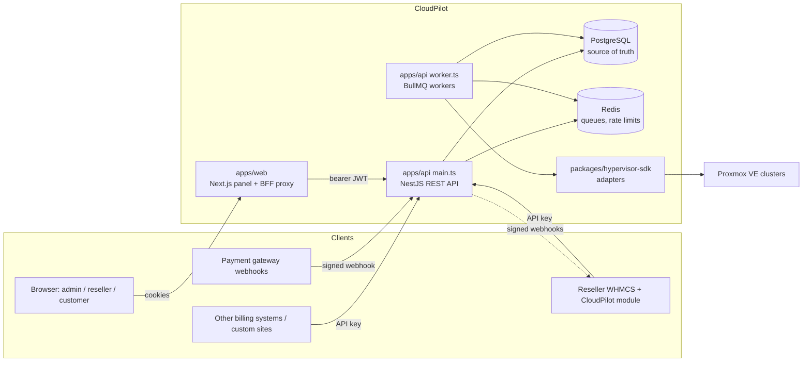
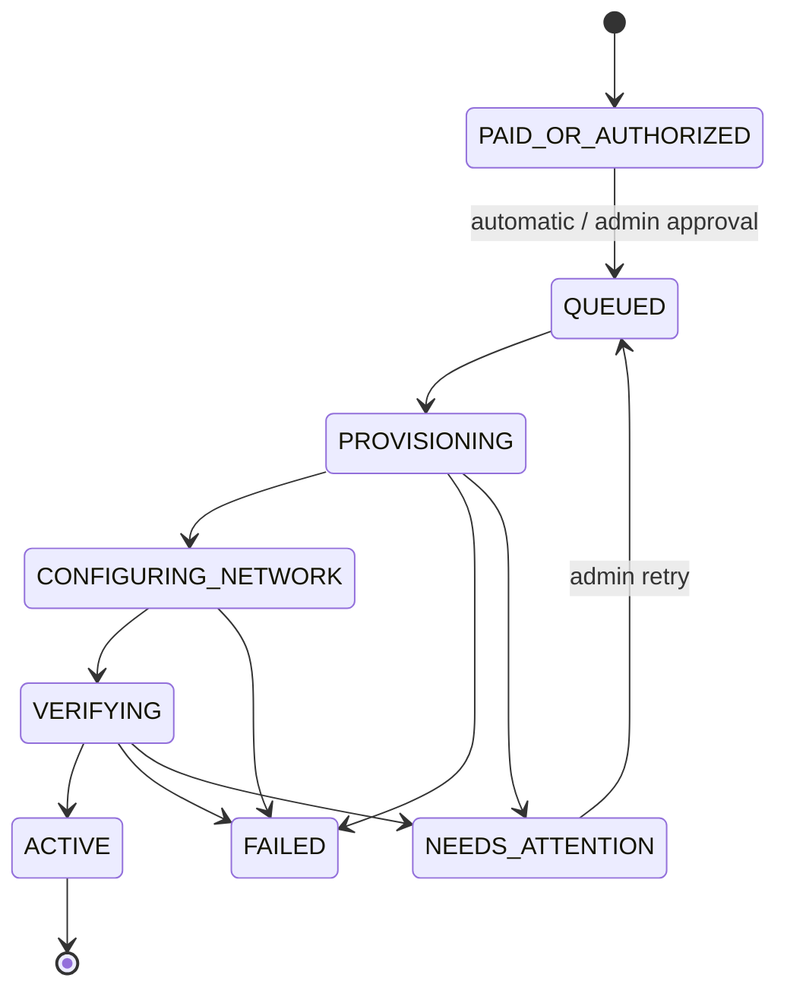
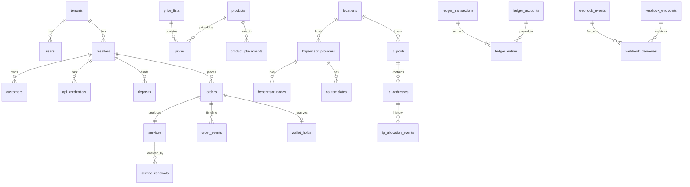

# CloudPilot architecture

CloudPilot is the control plane for Crapplet Cloud: it sells hosting directly and through
resellers, holds the money (wholesale wallets), owns IP inventory, and drives hypervisors.

## Components



| Path | Role |
|---|---|
| `packages/hypervisor-sdk` | Provider-neutral `HypervisorAdapter` contract, capability reporting, `ProxmoxAdapter`, `MockHypervisorAdapter`, contract tests against a TLS fake Proxmox. |
| `apps/api/src/modules/*` | Domain services as plain classes (ledger, ipam, catalog, orders, provisioning, service-ops, payments, auth, resellers, webhooks). No framework code inside. |
| `apps/api/src/http` | NestJS controllers, global access guard, error filter. Thin: parse with zod, call a service. |
| `apps/api/src/container.ts` | Composition root shared by the API, the worker, the seed script and the tests. |
| `apps/api/src/worker.ts` | Provisioning, service operations, webhook delivery, maintenance (outbox sweep, reservation expiry, stuck-order recovery, hourly ledger reconciliation). |
| `apps/api/drizzle/` | Versioned SQL migrations, including hand-written integrity triggers (0001, 0002, 0004). |
| `apps/web` | Next.js App Router UI. A same-origin BFF (`/api/cp/*`) adds the bearer token from an httpOnly cookie; browser JS never sees tokens. |
| `integrations/whmcs` | WHMCS server module (`modules/servers/cloudpilot`), wallet addon, live-API test. |
| `deploy/` | Native Ubuntu installer, systemd units, nginx, backup/restore/upgrade, Dockerfiles. |

## Key decisions

1. **Drizzle ORM instead of Prisma.** The brief named Prisma. Prisma's migration engine is a
   native binary downloaded at install time from `binaries.prisma.sh`, which the build
   environment blocked, so it could not be run or tested. Drizzle is pure TypeScript, gives typed
   queries and versioned SQL migrations, and makes the row-locking SQL the ledger needs
   (`SELECT … FOR UPDATE SKIP LOCKED`, deferred constraint triggers) first-class. Switching back
   is possible but would touch every service.
2. **Money is `bigint` minor units** end to end (DB `bigint`, TS `bigint`, JSON decimal strings
   with a `Minor` suffix). No floats anywhere in money paths.
3. **The database enforces the financial invariants**, not just the code (migration 0001):
   - balances change only via inserted ledger entries (trigger applies the entry under a row lock;
     direct `UPDATE … balance_minor` raises);
   - every transaction's entries sum to zero (deferred constraint trigger at COMMIT);
   - ledger rows are append-only (UPDATE/DELETE raise) — corrections are reversals;
   - `CHECK (balance_minor >= min_balance_minor)` stops overspending even under a code bug.
     Prepaid wallets have min 0; the credit account's min is `-creditLimit`.
4. **Settlement policy: hold → capture → release.** Ordering moves funds from *available* (and,
   for credit resellers, the credit line) into *reserved*. Capture to revenue happens only in the
   same DB transaction that marks the service ACTIVE after verification. Failure releases the hold
   back to its original sources.
5. **Idempotency everywhere money or VMs are created.**
   - Orders: unique `(tenant, reseller, idempotency_key)` + request fingerprint; replays return the
     original order, a key reused with a different payload is a 409.
   - Ledger: unique `(tenant, idempotency_key)` per posting (`hold:<order>`, `capture:<order>`,
     `deposit:<id>`, `renewal:<service>:<key>`).
   - VMs: the provider-side name `cp-<order number>` is deterministic; every provisioning run looks
     it up first and adopts an existing VM instead of creating another.
   - Gateway webhooks: unique `(gateway, event_id)` plus a row lock on the deposit.
6. **Durable jobs, never long work in HTTP.** Provisioning and service operations run in BullMQ
   workers with deterministic job ids. Service actions wait up to 25 s and otherwise return 202
   with an operation id. A transactional outbox (`webhook_events`/`webhook_deliveries`) plus a sweeper
   guarantees webhooks are not lost if Redis is.
7. **Source-of-truth split.** The billing DB is authoritative for orders and money; the hypervisor
   is authoritative for VM state. Failure handling never assumes: if cleanup of a partial VM cannot
   be confirmed, the order goes to `NEEDS_ATTENTION` with funds and IP still held.
8. **Secure by default HTTP.** The global guard denies any route without an explicit access policy.
   Admin routes check role permissions; reseller routes are scoped by `resellerId` on every query
   (other resellers' ids return 404, tested); API keys carry scopes and optional IP allowlists.

## Provisioning sequence

```mermaid
sequenceDiagram
  participant WH as WHMCS module
  participant API
  participant DB as PostgreSQL
  participant Q as BullMQ
  participant WK as Worker
  participant PVE as Proxmox
  WH->>API: POST /v1/reseller/orders (Idempotency-Key: whmcs:site:service:42)
  API->>DB: BEGIN; price; HOLD funds; RESERVE IP (bound to order); service row; QUEUED; outbox event; COMMIT
  API->>Q: add provision-<order>
  API-->>WH: 201 {status: QUEUED}
  WK->>DB: QUEUED→PROVISIONING
  WK->>PVE: find VM by name cp-N (adopt if exists) else clone template, set cloud-init, grow disk
  WK->>DB: record vm id; →CONFIGURING_NETWORK
  WK->>PVE: ipconfig0 / bridge / VLAN; start
  WK->>DB: →VERIFYING
  WK->>PVE: poll status: running + config IPs (+ guest-agent IP when available)
  WK->>DB: BEGIN; IP RESERVED→ALLOCATED; CAPTURE hold→revenue; service ACTIVE; order ACTIVE; outbox; COMMIT
  WH->>API: GET /orders/by-key/... (poll or cron hook)
  API-->>WH: ACTIVE + IPs
```

Failure path: retryable provider errors re-run the job with backoff (`PROVISIONING_MAX_ATTEMPTS`).
Permanent failure → find the VM by name → delete → confirm gone → release IP + funds → `FAILED`.
If the VM cannot be confirmed gone → `NEEDS_ATTENTION` (nothing released; admin retries).

## Order and service states



Transitions are enforced by `ORDER_TRANSITIONS` in `order.service.ts` under a row lock; every
transition writes an `order_events` row (the UI's activity timeline). IP states:
`AVAILABLE → RESERVED → ALLOCATED → QUARANTINED → AVAILABLE`, every change recorded by a DB trigger
in `ip_allocation_events`.

## Data model



The full schema is `apps/api/src/db/schema.ts`; the SQL is in `apps/api/drizzle/`.

## Ledger accounts

| Account | Owner | Sign | Min |
|---|---|---|---|
| `RESELLER_AVAILABLE` | reseller | + = owed to reseller | 0 |
| `RESELLER_RESERVED` | reseller | funds held for in-flight orders | 0 |
| `RESELLER_CREDIT` | reseller | − = credit drawn | −creditLimit |
| `RESELLER_PROMO` | reseller | promotional credit (not yet spendable) | 0 |
| `SYSTEM_GATEWAY_CLEARING`, `SYSTEM_BANK_CLEARING` | platform | counter-side of deposits | — |
| `SYSTEM_REVENUE` | platform | captured charges | — |
| `SYSTEM_ADJUSTMENTS` | platform | manual adjustments | — |

The trial balance (sum of all accounts per tenant) is always zero; the worker checks this hourly and
the admin overview shows the result.
